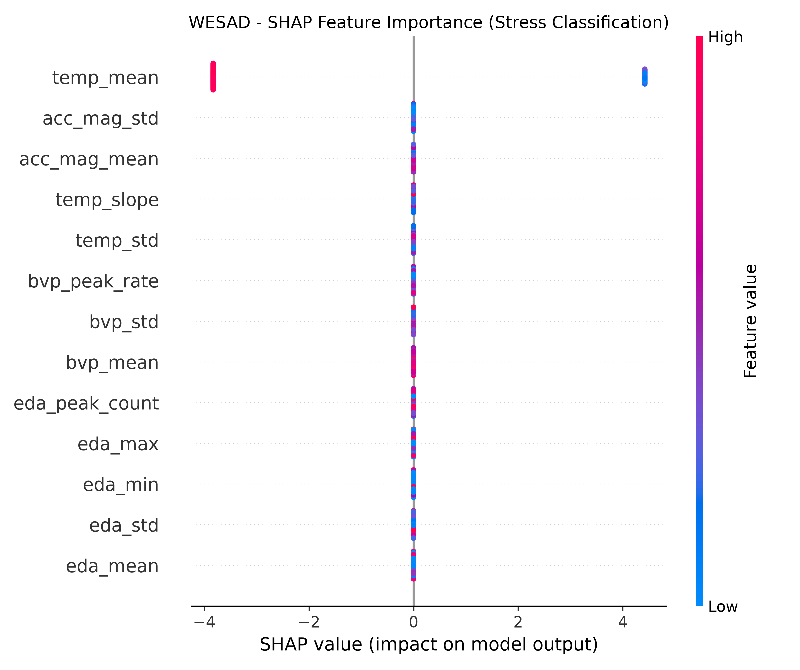
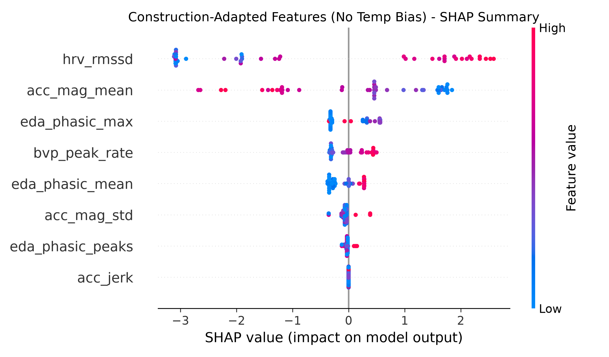

Explainable Stress Detection (WESAD) & Domain Adaptation to Construction Safety

This repository contains the code and benchmark results for a pilot feasibility study on physiological stress detection using the public **WESAD** (Wearable Stress and Affect Detection) dataset, interpreted via **TreeSHAP** (SHapley Additive exPlanations), and critically evaluated for translation into **construction site safety monitoring**.

1. Project Overview & Methodology Progression
The empirical experiment is organized into two sequential phases to demonstrate domain awareness and algorithmic interpretability:

### Phase 1: Baseline Lab Model (`01_wesad_baseline.py`)
Objective: Train an XGBoost classifier on raw statistical features from the Empatica E4 wristband (EDA, BVP, TEMP, ACC) using a 60-second sliding window (10s step).
Finding & Limitation: As revealed by TreeSHAP (`wesad_shap_summary.png`), the model relies almost entirely on `temp_mean` (SHAP \approx +4.4) under static room-temperature conditions. 
Site Risk: In outdoor construction environments, skin temperature is heavily confounded by ambient weather and physical exertion, which would cause severe false alarms.

### Phase 2: Construction-Adapted Feature Engineering (`02_wesad_construction_adapted.py`)
Objective: Conduct an ablation experiment eliminating raw skin temperature features to decouple physiological stress from environmental heat.
Refined Features: Introduced jerk dynamics (`acc_jerk`) for motion artifact tracking, high-pass filtered phasic skin responses (`eda_phasic`), and root-mean-square of successive differences (`hrv_rmssd`).
Result (`wesad_shap_construction_adapted.png`): Model attribution is successfully redistributed across autonomic reactivity (`eda_phasic`) and parasympathetic tone (`hrv_rmssd`), proving that stress can be classified without relying on temperature shortcuts.

---

## 2. SHAP Visualizations

| Phase 1: Lab Baseline (Shortcut on Temperature) | Phase 2: Construction-Adapted (Autonomic Dynamics) |
| :---: | :---: |
|  |  |

---

## 3. Next Steps: Multimodal Expansion for Construction Safety

Wristband wearables alone cannot distinguish acute cognitive stress from heavy manual labor or contextual site hazards. Future research will integrate a tripartite multimodal architecture:
1. **Wearable Sensing:** Continuous tracking of autonomic nervous system reactivity (HRV, EDA).
2. **EEG (Smart Helmet):** Direct measurement of cognitive workload, mental fatigue, and inattention via frontal theta/beta spectral power ratios.
3. **Computer Vision (CV):** Real-time ergonomic posture tracking (RULA score) and worker-equipment proximity detection to provide situational context.

---

## 4. How to Run Locally

### Prerequisites
```bash
pip install -r requirements.txt
